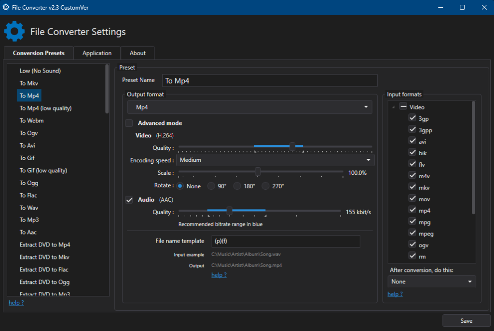
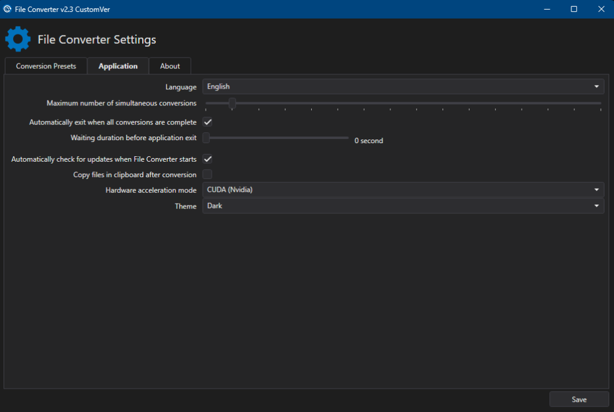

# File Converter (GPU Acceleration & Dark Theme Edition)

**File Converter** is an open-source, highly efficient utility that allows you to convert and compress audio, video, image, and document files directly from the Windows Explorer right-click context menu.

This custom edition builds upon the 2.3 maintenance baseline, adding full **NVIDIA GPU hardware acceleration (NVENC & CUVID)** for ultra-fast media conversions and a complete, modern **Dark Theme** with Windows 10/11 system title bar support.

  
  

---

## 📥 Downloads & Installation

| Package | Format | Description |
| :--- | :--- | :--- |
| **[Windows Installer (MSI)](https://github.com/cosong/FileConverter/releases/download/v2.3.1-custom/FileConverter-2.3.1-CustomVer-GPU-DarkTheme.msi)** | `.msi` | Recommended. Installs the application and registers the Windows Explorer context menu extension. |
| **[Portable Archive (ZIP)](https://github.com/cosong/FileConverter/releases/download/v2.3.1-custom/FileConverter-2.3.1-CustomVer-Portable.zip)** | `.zip` | Standalone portable build. Extract and run without installation. |

> All official releases and asset downloads are available on the **[Releases Page](https://github.com/cosong/FileConverter/releases)**.

---

## 🚀 Key Features & Changes

### ⚡ Full NVIDIA GPU Hardware Acceleration (CUDA / NVENC / CUVID)
- **Hardware-Accelerated Decoding (`cuvid`)**: Automatic hardware decode pipelines for **AV1** (`av1_cuvid`), **HEVC/H.265** (`hevc_cuvid`), **H.264** (`h264_cuvid`), and **VP9** (`vp9_cuvid`).
- **10-Bit & HDR Safeguard**: Automatic pixel format normalization (`format=yuv420p`) when feeding 10-bit HDR/AV1 inputs into NVENC, preventing encoder initialization crashes.
- **Up to 5x Faster Encoding**: Massive speedup for video encoding and downscaling (e.g., 4K AV1 to 1080p MP4 takes ~4 minutes instead of ~20+ minutes on an RTX 40-series GPU).
- **Graceful Fallback**: If hardware decoding is not supported for a specific codec or GPU, processing seamlessly falls back to optimized multi-threaded CPU decoding.

### 🌙 Complete Modern Dark Theme
- **Deep Dark Aesthetic**: Consistent dark backgrounds, borders, and text across the entire interface (Settings, Diagnostics, Help, Upgrade windows).
- **Theme Switcher**: Select between **System**, **Dark**, and **Light** themes at any time in the **Application** settings tab.
- **Windows 10 / 11 DWM Integration**: Automatically styles the native OS window title bar and border to match the dark theme via Desktop Window Manager (`DwmSetWindowAttribute`).
- **Fully Restyled Controls**: Custom dark styling for TabControls, TreeViews, ComboBoxes, Sliders, ScrollBars, CheckBoxes, RadioButtons, GroupBoxes, and Context Menus.

### 🌐 Ukrainian Localization (Українська локалізація)
- **Complete Native Translation**: Full translation of the entire application, preset editor, application settings, diagnostics, and context menu integrations into Ukrainian (`uk` / `uk-UA`).
- **Automatic Detection**: Automatically activates when Windows UI language is Ukrainian, or can be manually selected in **Settings** > **Application** > **Language** (`Українська`).

### 🛡️ Core Stability & Bug Fixes (2.3 Baseline)
- Resolved Microsoft Word and Office document conversion crashes and stalls.
- Fixed FFmpeg process pipe deadlocks during long audio/video conversions.
- Fixed video resizing hangs and NVENC filter graph scaling issues.
- Fixed MKV progress reporting and audio stream mapping regressions.

---

## ⚙️ System Requirements

- **Operating System**: Windows 10 (64-bit) or Windows 11 (64-bit).
- **GPU (for Hardware Acceleration)**: NVIDIA GeForce GTX 900-series or newer (RTX 20/30/40/50 series recommended) with updated NVIDIA drivers.
- **CPU**: 64-bit multi-core Intel or AMD processor.

---

## 📖 How to Use

1. **Convert via Context Menu**:
   - Right-click one or more media files in Windows Explorer.
   - Hover over **File Converter** and choose your target preset (e.g., `To Mp4`, `To Webm`, `To Mp3`, `To Flac`).
2. **Configure Settings & Presets**:
   - Open **File Converter Settings** from the Start Menu or via right-click > *File Converter* > *Configure presets...*
   - Customize output bitrates, encoding speeds, scaling factors, or create new custom presets.
   - In the **Application** tab, adjust concurrent conversion limits, hardware acceleration preference, and choose your preferred **Theme** (Dark / Light / System).

---

## 📄 License

File Converter is released under the [GNU General Public License v3.0](LICENSE.md).
